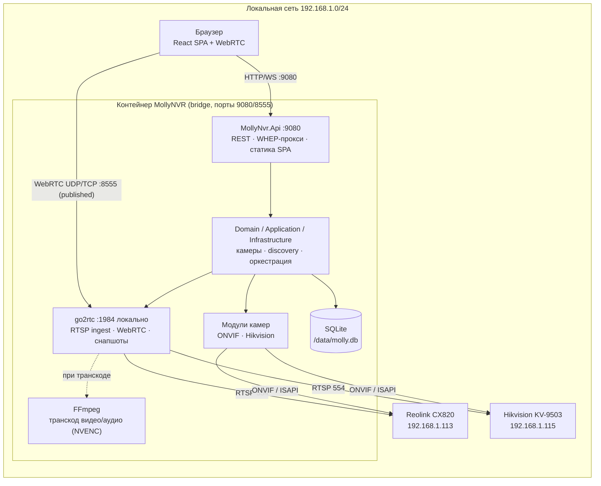
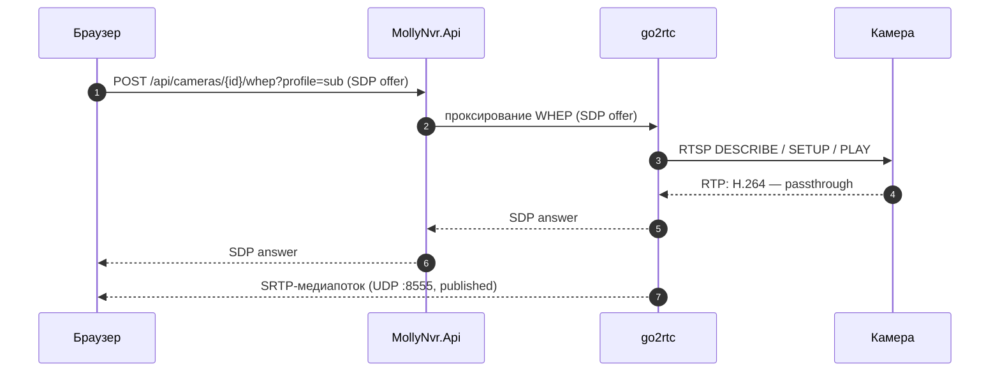
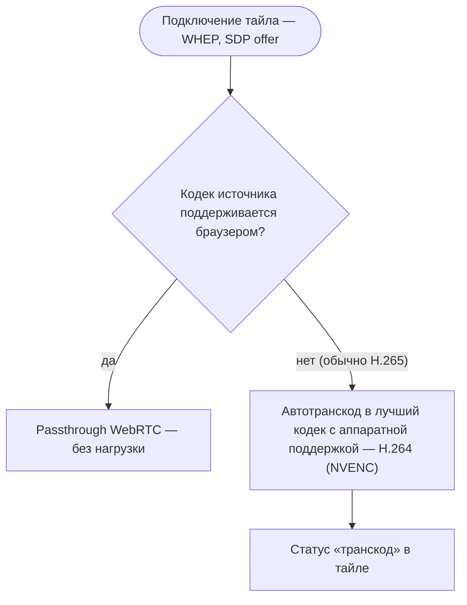
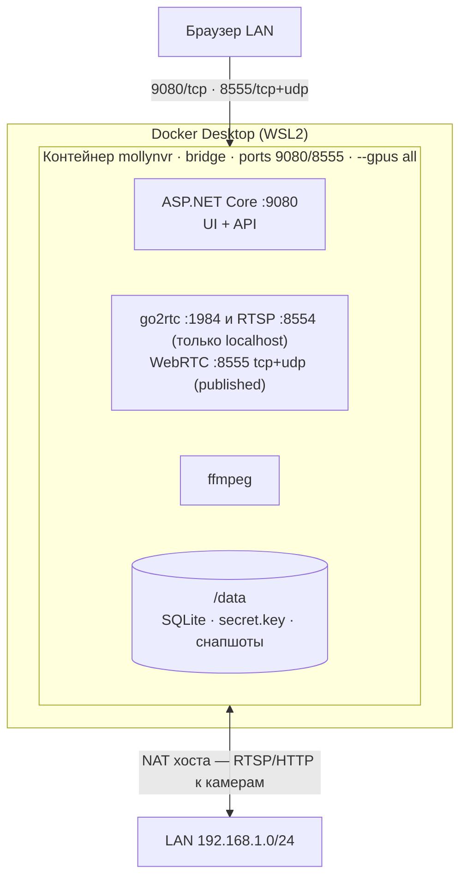

# Архитектура MollyNVR

**Статус:** черновик v0.1 на согласование · **Дата:** 2026-10-18 · **Стек:** .NET 10 + React

---

## 1. Цели и принципы

- **Простота эксплуатации:** всё решение — один Docker-образ; запуск — `docker compose up -d`. Обновление — пересборка образа.
- **Максимум автоматизации:** автопоиск камер, подстановка профилей, самостоятельное определение кодеков, минимум ручных настроек.
- **Live-просмотр — ядро v1.** Запись, детекция, AI — только архитектурный задел (интерфейсы и точки расширения).
- **Passthrough по умолчанию:** видео идёт без перекодирования; транскод включается только при несовместимости и автоматически (со статусом в UI).
- **Модульность производителей:** каждая марка камеры — подключаемый модуль (плагин) за стабильным контрактом.
- **Локальность:** приложение для LAN, личное использование; никаких облаков.

## 2. Согласованные решения

| Вопрос | Решение |
|---|---|
| Объём v1 | Только live-просмотр (раскладки, фокус, аудио). Запись и AI — задел |
| Камеры | `192.168.1.113` Reolink CX820, `192.168.1.115` Hikvision KV-9503; всего в сети 4 — остальные через автопоиск |
| Аудио | Только у тайла в фокусе (один клик — фокус + звук, звук переезжает при смене тайла), общий mute в тулбаре |
| Сеть Docker | bridge + публикация портов `9080/tcp`, `9443/tcp` (HTTPS для PWA), `8555/tcp`, `8555/udp`. Причина: host networking в Docker Desktop на Windows не пробрасывает UDP внутрь контейнера (проверено на M1), а WebRTC-медиа идёт по UDP. Автопоиск (multicast) — отдельная задача M3, см. §15 риск 1 |
| H.265 | Автоматически при просмотре: passthrough, если браузер поддерживает кодек; иначе автотранскод в лучший кодек с аппаратной поддержкой (NVENC). Мастер добавления ничего не спрашивает |

**Железо хоста (проверено):** Ryzen 5 5600 (6 ядер/12 потоков), **RTX 3060 Ti** (NVENC/NVDEC — аппаратный транскод), 16 ГБ RAM. Свободно: C: 6 ГБ (!), D: 91 ГБ, E: 142 ГБ. Docker Desktop 29.8.2 (WSL2). Сеть хоста — `192.168.1.151/24`.

> ⚠️ На диске C всего 6 ГБ. Образы Docker и WSL-VHDX по умолчанию живут на C — до сборки нужно перенести data-root Docker или чистить место (см. §11).

## 3. Контекст и компоненты



| Компонент | Ответственность |
|---|---|
| **SPA (React + TS + Vite)** | Раскладки, тайлы, фокус/аудио, fullscreen, мастер добавления камеры. Отдаётся Kestrel как статика — единый origin |
| **MollyNvr.Api** | REST API, WHEP-прокси к go2rtc (наружу торчит только :9080), health |
| **Domain / Application / Infrastructure** | Домен и use cases: реестр камер, оркестрация discovery, управление потоками. Инфраструктура: SQLite (EF Core), клиент go2rtc, запуск ffmpeg, шифрование кредов |
| **Модули производителей** | Модули `ICameraModule`: discovery, проверка подключения, профили, снапшот. Реализация — отдельные .NET-проекты в солюшене, регистрируются через DI. Для Reolink без RTSP/ONVIF — модуль поверх моста `neolink.net` (Baichuan, порт 9000) |
| **go2rtc** (MIT) | Медиа-ядро: забирает RTSP, отдаёт WebRTC (WHEP) / MSE / снапшоты, при необходимости сам запускает ffmpeg-транскод источника |
| **FFmpeg** | Транскод видео (H.265→H.264, NVENC/CPU) и аудио (→ Opus) при несовместимости |
| **SQLite** | Камеры и профили. Креды — шифрованно (§12) |

**Почему go2rtc:** MIT-лицензия, один бинарник, динамическое управление источниками через HTTP API, встроенная обвязка ffmpeg для транскода «на лету», WebRTC/MSE/HLS из коробки, зрелость (используется в Frigate и Home Assistant). Альтернатива — MediaMTX — зрелее в части записи, но требует внешнего транскода и менее динамична; запись сделана отдельным ffmpeg-сегментатором, поэтому выбран go2rtc.

## 4. Путь видео (live)



- Тайлы сетки подключаются к **субпотоку**; двойной клик — fullscreen тайла и **основной поток** в максимальном разрешении; кнопка «На весь экран» разворачивает всю сетку, выход — `Esc`.
- Каждый тайл — отдельная WebRTC-сессия (WHEP). Аудио-трек включается только у тайла в фокусе; остальные сессии muted. Общий mute в тулбаре выключает звук у всех видео, включая активный тайл.
- go2rtc слушает `127.0.0.1:1984` (API/signalling — только через прокси backend), `127.0.0.1:8554` (внутренний RTSP: публикация `ffmpeg:`-источников и будущего транскода; наружу не торчит) и `:8555` TCP/UDP — медиа для браузеров LAN (порт публикуется Docker'ом).
- Задержка WebRTC (SRTP/UDP, passthrough) — доли секунды, без HLS-буферизации.

## 5. Определение возможностей браузера и политика кодеков

Твой вопрос: «есть ли возможность определить, что браузер поддерживает видео и аудио поток?» — **да, но 100% гарантии «заранее» нет**. Правильная схема — комбинированная:

1. **Точный факт — SDP-негоциация WebRTC.** В offer браузер сам перечисляет кодеки, которые готов принять. Если кодек камеры есть в offer — passthrough; нет — транскод. Проверка происходит в момент подключения, ошибиться невозможно.
2. **Заблаговременные эвристики (для UI):**

```ts
RTCRtpReceiver.getCapabilities('video')?.codecs            // кодеки WebRTC текущего браузера
MediaSource.isTypeSupported('video/mp4; codecs="hvc1.1.6.L120.90"')  // H.265 в MSE
await navigator.mediaCapabilities.decodingInfo({           // хватит ли железа и плавно ли
  type: 'file', video: { contentType: 'video/mp4; codecs="hvc1"' }
});
```

**Практическая матрица:**

| Кодек | WebRTC в Chrome/Edge | WebRTC в Firefox | Вывод |
|---|---|---|---|
| H.264 | Да | Да | Passthrough везде |
| H.265 | Только при аппаратном декодировании (обычно да на NVIDIA) | Нет | Не полагаться — при просмотре решается автоматически |
| Аудио G.711 (PCMU) | Да | Да | Passthrough |
| Аудио AAC | Нет (не входит в WebRTC) | Нет | Транскод → Opus |

**Автоматическая политика при просмотре.** Решение принимается в момент подключения каждого тайла, без диалогов — мастер добавления ничего не спрашивает (у разных людей разные браузеры, привязываться к выбору при добавлении камеры неверно):
- кодек источника есть в SDP offer браузера → **passthrough**, нулевая нагрузка;
- иначе → **автотранскод в лучший целевой кодек**: выбирается лучший кодек, который одновременно поддерживает браузер и аппаратно умеет сервер (RTX 3060 Ti через NVENC: H.264/H.265; практический выбор — H.264, его принимают все браузеры). Аудио при необходимости — транскод в Opus.

Результат держится на время сессии; статус «транскод» виден в тайле. Смена кодека камеры вручную не предусмотрена — политика полностью автоматическая.

**Аудио (реализовано в M4):** если кодек камеры не входит в WebRTC (AAC, G.722.1), к потоку добавляется второй источник `ffmpeg:<rtsp>#audio=opus`; видео остаётся passthrough из RTSP, ffmpeg занимается только звуком. Для PCMU/PCMA транскод не требуется.

**Видео (реализовано в M5):** для H.265-профилей добавляется резервный источник `ffmpeg:<rtsp>#video=h264#hardware` (авто-выбор CUDA/NVENC). go2rtc запускает его только если в SDP offer браузера нет H.265; при поддержке H.265 идёт passthrough без ffmpeg. Статус «транскод» показывается в тайле, фактические кодеки — в оверлее по наведению на Live.



## 6. Модули производителей

Контракт (фактический, `src/MollyNvr.Cameras.Abstractions/ICameraModule.cs`):

```csharp
public interface ICameraModule
{
    string Key { get; }                       // "onvif", "hikvision"
    string DisplayName { get; }
    Task<bool> CanHandleAsync(CameraEndpoint endpoint, CancellationToken ct);
    Task<CameraProbeResult> ProbeAsync(CameraEndpoint endpoint, CameraCredentials credentials, CancellationToken ct);
    Task<byte[]> GetSnapshotAsync(CameraEndpoint endpoint, CameraCredentials credentials, CameraProfile profile, CancellationToken ct);
    // задел: автопоиск (DiscoverAsync), PTZ, события, детекция движения
}
```

- **Подключение:** модуль — это отдельный .NET-проект в солюшене (`MollyNvr.Cameras.ONVIF`, `MollyNvr.Cameras.Hikvision`), регистрируется через DI в `MollyNvr.Infrastructure`. Добавить производителя = добавить проект + регистрацию. Контракт — в `MollyNvr.Cameras.Abstractions`; модули зависят только от него (не от Domain/Application/Infrastructure).
- **Учётные данные:** в контракте передаются отдельным объектом `CameraCredentials`; URL потоков, отдаваемые наружу, — без кредов (`RtspUriFactory` добавляет их только для внутренних вызовов). Пароли не пишутся в логи.
- **ONVIF (общий модуль):** Device/Media-сервисы ONVIF, WS-Security UsernameToken (PasswordDigest), RTSP через `GetStreamUri`, снапшот через `GetSnapshotUri`, DHCP через `GetNetworkInterfaces`. Профили main/sub определяются по максимальному разрешению; аудио читается из `AudioEncoderConfiguration` (кодек, частота, битрейт). Такой модуль обслуживает Reolink и другие ONVIF-совместимые камеры без отдельного проекта производителя. Для Reolink CX820 ONVIF доступен на порту **8000**, HTTP-порт 80 может быть закрыт — тогда снапшот берётся кадром из RTSP. Кодеки уточняются по SDP (RTSP DESCRIBE).
- **Hikvision KV-9503:** ISAPI на :80 (HTTP Digest), RTSP `/Streaming/Channels/101` (main) и `/102` (sub); ISAPI даёт точные кодеки/разрешения/fps/аудио, снапшот `/ISAPI/Streaming/channels/{id}/picture`. SDK-порт 8000, ONVIF `/onvif/device_service` — не используются.
- **Снапшот (M2):** сначала нативный метод модуля, при недоступности — кадр из RTSP через go2rtc (`/api/frame.jpeg?src=…`); так работает и для ONVIF-камер с закрытым HTTP-портом.
- Профили субпотока (разрешение/кодек/аудио) вычитываются и показываются в мастере — как ты и просил, «форматы видео и аудио».

## 7. Автопоиск

| Метод | Транспорт | Что находит |
|---|---|---|
| ONVIF WS-Discovery | UDP multicast 239.255.255.250:3702 | Камеры/NVR с ONVIF, XAddrs (имя из scopes как модель не используется — это аппаратный идентификатор) |
| SSDP/UPnP | UDP multicast 239.255.255.250:1900 (M-SEARCH) | Описание устройства: производитель, модель; фильтр по камерам/NVR |
| mDNS/Bonjour | UDP multicast 224.0.0.251:5353 (`_rtsp`, `_onvif`, `_http`) | IP-адреса камер из A-записей |
| Hikvision SADP | UDP 37020 (multicast/broadcast) | Hikvision: MAC, модель, IP |
| Скан подсети (Unicast) | ICMP-опрос диапазона, затем TCP connect только по живым хостам (таймаут 4 с, один повтор на молчаливый SYN) | Всё, что отвечает; производитель — MAC/OUI, ответ протокола или модуль |
| IP-адрес | TCP connect по типовым портам одного адреса | Конкретное устройство; вендор — выбранный модуль или автоопределение |

После обнаружения — идентификация производителя: MAC → OUI (компактный справочник IEEE в `Application/Discovery/oui-cameras.csv`) важнее названия протокола («ONVIF» — не производитель), затем ответ multicast-протокола, затем `CanHandleAsync` модулей. В таблице результата — IP, MAC, производитель, модель и открытые порты; кнопка «Подключиться» доступна всегда.

**Unicast:** CIDR/диапазон/одиночный адрес; API возвращает все найденные устройства, а мастер скрывает уже добавленные камеры (по списку сохранённых). Сначала ICMP-опрос диапазона (только отвечающие хосты), затем быстрый набор портов камер, затем полный список портов у найденных хостов; результат объединяется. ICMP-предфильтр важен для Docker Desktop: полный перебор портов по /24 создаёт лавину соединений, которую теряет NAT, а камеры с Wi-Fi power save отвечают на SYN за 1–3 секунды. Поэтому таймаут порта — 4 с с одним повтором при молчаливом таймауте (явный RST не повторяется), а уже найденные порты повторно не проверяются. Если ICMP недоступен или никто не ответил — сканируется весь диапазон (медленный путь). Хосты только с HTTP-портами (роутеры) отбрасываются. **IP:** строка результата возвращается даже без открытых портов. **Multicast:** в результаты попадают только устройства, у которых открыт хотя бы один порт камеры (554, 8554, 8000, 9000, 34567, 37777) — роутеры и веб-панели отбрасываются. Дополнительно сканируются известные ARP-соседи: так находятся камеры, которые не отвечают на multicast (например, Reolink с отключёнными ONVIF/HTTP). Отправка идёт через явно выбранный LAN-интерфейс (`MulticastInterface`): VPN-адаптеры (Wintun/WireGuard) часто перехватывают маршрут `224.0.0.0/4`, и без этого multicast молча не находит ничего. Контейнер в bridge-сети LAN напрямую не видит, поэтому методы возвращают пустой список; UI показывает предупреждение и предлагает скан подсети. На хосте/Linux multicast работает; для этого есть `scripts/run-local.ps1`. См. §15, риск 1.

**Reolink без RTSP/ONVIF (Baichuan):** некоторые камеры (например, E1 с выключенными HTTP/ONVIF/RTSP) доступны только по проприетарному протоколу на порту 9000. Для них поднимается отдельный сервис `reolink` — `neolink.net` (AGPL-3.0, отдельный процесс, см. `docs/third-party/neolink.net.md`): входит в камеру по Baichuan и отдаёт RTSP + HTTP-API. Модуль `MollyNvr.Cameras.Reolink` при выборе производителя сначала пробует стандартный ONVIF, затем Baichuan: записывает камеру в `data/reolink/config.json` (мост перезапускается), ждёт `online`, берёт профили из `/api/cameras/<name>/streaminfo`, стоп-кадр — из `/api/cameras/<name>/snapshot.jpg`, а потоки — `rtsp://reolink:8654/<name>/mainStream|subStream`.

### Запись видео

Движок — отдельный `ffmpeg` на камеру (видео `-c copy`, аудио в AAC: G.711/PCM несовместимы с fMP4; сегменты по 5 минут), источник — внутренний RTSP go2rtc (`rtsp://127.0.0.1:8554/camera-<id>-main|sub`): камера держит одно соединение, пароль не попадает в командную строку. Фоновый `RecordingWorker` раз в 10 с сверяет расписания и запускает/останавливает процессы. Сегменты индексируются в `recording_segments`; `SegmentIndexer` оставляет только те, что пересекаются с окнами потокового расписания или с событиями (+pre/post-roll), остальные удаляет с задержкой (pre-roll для ещё не наступивших событий). `StorageRetention` держит квоту пула: FIFO или водяные знаки (high/low от квоты).

События: `ICameraEventSource` у модулей — ONVIF PullPoint (`CreatePullPointSubscription`/`PullMessages`) и Hikvision ISAPI `alertStream` (multipart XML). `CameraEventMonitor` пишет окна в `recording_events`. Reolink через мост Baichuan событий не отдаёт — только расписание.

API: `GET/PUT /api/cameras/{id}/recording`, `GET/PUT /api/settings/storage`. Таблицы: `recording_settings`, `recording_segments`, `recording_events`, `storage_settings` (EF Core, миграция `AddRecording`).

### Архив

`/api/archive/*`: камеры, календарь по месяцам, таймлайн за день (интервалы записей + события) и HLS-воспроизведение. `ArchiveService` выбирает окно 2 часа от запрошенного момента, склеивает сегменты и запускает `ffmpeg` через `PlaybackSessionManager` (copy для H.264, hvc1 для HEVC или транскод в H.264, если браузер не поддерживает HEVC). Готовые HLS-файлы раздаются через API, кэш — `<data>/playback-cache`, устаревшие сессии убирает `PlaybackCleanupService`. UI — `hls.js` (загружается отдельным чанком).

### Архив

Индекс сегментов и событий читается через `ArchiveService`: календарь (дни с записями), таймлайн за сутки (непрерывные интервалы + окна событий) и список камер. Время в `recording_segments`/`recording_events` хранится в UTC (`DateTime`), поэтому SQLite корректно фильтрует по интервалам; миграция `NormalizeRecordingTimes` переводит старые значения.

Воспроизведение — HLS по запросу. `PlaybackSessionManager` берёт сегменты от точки клика на 2 часа вперёд (в пределах суток), склеивает их `ffmpeg -f concat` и раздаёт плейлист с фрагментами из `/data/playback-cache`; сессии живут по TTL и удаляются по `DELETE`. H.264 отдаётся `-c copy`, H.265/MJPEG перекодируются в H.264, если браузер не заявил поддержку HEVC. API возвращает карту «медиа-время → реальное время»: по ней клиент рисует красную риску и счётчик времени на записи. Пропуски между записями схлопываются при склейке, поэтому воспроизведение перескакивает их автоматически.

## 8. UI


- **Навигация:** полноэкранный макет, слева — «Прямая трансляция», «Архив», «Камеры», «Настройки». Версия, .NET и статус go2rtc — в «Настройках».
- **Раскладки:** 1, 2, 4 (2×2), 4 с большим тайлом, 6 (3×2), 6 с двумя большими тайлами, 9, 12 с большим тайлом и 12 (равномерная). 4 с большим тайлом — сетка 4×3: тайл 3×3 слева и 3 камеры в правой колонке; 6 с двумя большими — сетка 4×3: два тайла 2×2 сверху (слева и справа) и 4 камеры в нижнем ряду; 9 — сетка 4×3, большой тайл 2×2 слева сверху и 8 малых; 12 с большим тайлом — сетка 5×4, большой тайл 3×3 слева сверху и 11 малых; 12 (равномерная) — сетка 4×3. Выбор — иконка сетки, по клику попап с миниатюрами и количеством тайлов; активная подсвечена синим.
- **Тулбар сетки:** слева от выбора раскладки — общая кнопка включения/выключения звука; после раскладки — кнопка «На весь экран» (нативный Fullscreen API для всей сетки, выход по `Esc`), затем «Растянуть изображение»; во включённом состоянии кнопки подсвечены синим, видео во всех тайлах заполняет площадь (`object-fit: fill`). Иконки тулбара одного серого цвета, как у раскладки. Состояния звука, растяжения, раскладки, фокуса и порядка тайлов хранятся в `localStorage` браузера, на сервере не сохраняются.
- **Каждый тайл:** активные камеры автоматически занимают свободные места; порядок можно менять перетаскиванием (тайлы меняются местами), он запоминается отдельно для каждой раскладки в браузере. Лишние камеры не показываются.
- **Взаимодействие:**
  - один клик — фокус (рамка) + звук этой камеры; клик по другому тайлу — звук переезжает;
  - колесо мыши — масштаб изображения под курсором (1×–6×); увеличенное изображение перетаскивается левой кнопкой мыши, панорамирование ограничено краями тайла;
  - у активного тайла — иконка громкости с ползунком (Windows 11); при нулевой громкости, общем mute или недоступном кодеке — красная иконка;
  - двойной клик — fullscreen тайла + основной поток в максимальном разрешении; повторный двойной (или Esc) — возврат в сетку (субпоток, звук остаётся на фокусе);
  - кнопка «На весь экран» в тулбаре разворачивает всю сетку; выход — `Esc`;
  - при курсоре в нижней трети тайла снизу по центру плавно (200 мс) появляются круглые кнопки «Инфо» (оверлей с параметрами камеры) и «Настройки» (переход на страницу настроек камеры); при наведении кнопка светлеет, при нажатии/активном состоянии подсвечивается синим.
- **Индикаторы:** индикатор Live скрыт; показываются только состояния connecting / failed. При обрыве или перезапуске go2rtc тайл автоматически переподключается через 5 секунд. Кодек на изображении не показывается; при транскоде видео — бейдж «транскод». Информационный оверлей (кнопка «Инфо») показывает название камеры и параметры видео/аудио; строки «Видео транскодировано» и «Аудио транскодировано» показываются только при реальной перекодировке (для видео — по фактическому кодеку SDP answer). Если звук недоступен из-за кодека — красная иконка со знаком запрета; при mute — красный перечёркнутый динамик.
- **Мастер добавления (4 шага, реализовано):** 1) поиск — Multicast (WS-Discovery/SSDP/mDNS/SADP), Unicast (CIDR/диапазон) или IP-адрес; таблица результатов: IP, MAC, производитель, модель, открытые порты, «Подключиться»; уже добавленные камеры скрыты. 2) подключение — адрес, логин, пароль, производитель (ONVIF + подключённые модули), карточка устройства. 3) профили — таблица всех профилей с radio: основной выбран автоматически по максимальному разрешению и заблокирован, дополнительные пронумерованы, по умолчанию выбран минимального разрешения; у каждого свой стоп-кадр. 4) сохранение — метаданные, имя камеры, стоп-кадр основного потока вместо превью, сводка выбранных потоков. Навигация: клик по любому предыдущему шагу. После сохранения камера появляется в свободном тайле сетки.
- **M3 (реализовано):** страница «Камеры»: список сохранённых камер, удаление, включение/выключение, переход к настройкам; кнопка «+ Добавить» открывает мастер, автопоиск встроен в первый шаг мастера. Колонка включения — первая, без заголовка, с переключателем; отключённая строка притемнена. Далее колонки «Название» и «Производитель» в этом порядке. После сохранения камера переживает перезапуск контейнера.
- **Настройки камеры (реализовано):** `/cameras/:id/settings` — живой preview с изображением и звуком, параметры устройства (производитель, модель, прошивка, серийный номер, адрес, DHCP), обязательное название, таблица потоков с подсветкой битрейта и переключателем выбора субпотока (основной всегда включён и заблокирован, субпотоки — радиокнопки). Разрешение показывается в формате `1920×1080 Full HD · 2,1 Мп · 16:9`; кодеки подсвечиваются по поддержке браузера и доступности ffmpeg-транскода, при отключённом аудио — нейтральный прочерк. Кнопка ▶ в строке потока переключает preview на основной или конкретный субпоток; при открытии активен основной поток. Сохранение — по кнопке «Сохранить» (`PUT /api/cameras/{id}/settings`) с зелёным toast на 3 секунды; кнопка «Назад» возвращает на предыдущую страницу. DHCP запрашивается по `GET /api/cameras/{id}/network`; черновик в мастере показывает «Без живого preview».
- **M4 (реализовано):** раздел «Прямая трансляция»: раскладки 1, 2, 4 (2×2), 4 с тайлом 3×3, 6 (3×2), 6 с двумя тайлами 2×2, 9, 12 с большим тайлом и 12 (равномерная); активные камеры занимают свободные тайлы; drag & drop меняет тайлы местами и запоминается для каждой раскладки; клик — фокус, иконка громкости только у активного тайла (ползунок в стиле Windows 11; mute — красный перечёркнутый динамик, недоступный кодек — красный знак запрета), общий mute слева от раскладки; колесо мыши — зум под курсором, увеличенное изображение панорамируется левой кнопкой; двойной клик — fullscreen тайла с основным потоком, кнопка «На весь экран» — fullscreen всей сетки (выход по Esc); аудио AAC → Opus через ffmpeg-источник; кнопки «Инфо» и «Настройки» появляются при курсоре в нижней трети тайла; индикатор Live скрыт, показываются connecting/failed; раскладка, порядок, фокус, растяжение и mute сохраняются в `localStorage`. В «Сохранённых камерах» — переключатель активна/выключена и редактирование (неактивные скрыты из сетки, их потоки снимаются с go2rtc). В левом верхнем углу тайла при активной записи — мигающая точка `REC` и иконки триггеров (расписание и/или открытые события, опрос `GET /api/recording/status` раз в 5 с); кнопка «Архив» в панели тайла открывает архив с этой камерой.
- **M6 (реализовано): архив.** Отдельная вкладка «Архив»: под пунктом меню — список активных камер, камера по умолчанию не выбрана; выбор камеры грузит календарь и таймлайн. Сверху плеер, под ним панель управления (дата, время, фильтры, транспорт, скорость 1/2/4/8, просмотр нескольких камер), таймлайн 0–24 ч; дата открывает календарь вверх (точки на днях с видео, закрытие по выбору даты или Esc). На таймлайне серые полосы — расписание, синие поверх — события; перетаскивание — прокрутка, клик — воспроизведение с ближайшей записи справа, красная риска — текущая позиция. «Просмотр нескольких камер» делит область на 4 тайла: камеры перетаскиваются из меню, тайлы меняются местами, воспроизведение синхронное; под общей шкалой времени — по полоске на камеру в порядке тайлов, активная подсвечена, звук идёт только с неё, красная риска общая. Плеер и сетка занимают всё свободное место, панель управления и таймлайн прижаты к низу. Кнопки «Запись» и «Стоп кадр» находятся на изображении и появляются при наведении; запись показывает мигающую точку и `REC чч:мм:сс`. Запись и стоп-кадр выполняются в браузере (`MediaRecorder` + canvas), формат (PNG/JPEG, WebM/MP4) хранится в `localStorage` (раздел «Настройки»). Кнопка «На весь экран» — на панели управления (разворачивает плеер или сетку 2×2). Дата по умолчанию — сегодня. Из тайла прямой трансляции кнопка «Архив» открывает архив с этой камерой.
- **PWA:** `manifest.webmanifest`, service worker (кеширует оболочку, API/HLS не кешируются), иконки 192/512 и maskable; `start_url=/live`, `display=standalone`. Установка как приложение требует HTTPS: на `http://<LAN-IP>:9080` service worker недоступен (исключение — localhost).
- Русский язык по умолчанию. Все строки UI — через словари локализации (i18n): заложена возможность выбора языка в настройках; сам выбор в v1 не реализуем.

## 9. Стек и структура решения

```
MollyNvr.slnx                       # чистая архитектура (.slnx — формат решений .NET 10)
├─ src/
│  ├─ MollyNvr.Domain/              # сущности, value objects, доменные интерфейсы (порты)
│  ├─ MollyNvr.Application/         # use cases: AddCamera, ScanNetwork, OpenStream, CodecPolicy…
│  ├─ MollyNvr.Infrastructure/      # EF Core + SQLite, клиент go2rtc, запуск ffmpeg,
│  │                                # WS-Discovery/SADP/скан, шифрование кредов — реализации портов
│  ├─ MollyNvr.Api/                 # ASP.NET Core: REST, WHEP-прокси, статика SPA, хост go2rtc
│  ├─ MollyNvr.Cameras.Abstractions/# контракт модулей производителей (ICameraModule, DTO)
│  ├─ MollyNvr.Cameras.ONVIF/
│  └─ MollyNvr.Cameras.Hikvision/
├─ ui/                              # React 19 + TypeScript + Vite
├─ tests/                           # xUnit: Domain, Application, Infrastructure (EF/SQLite, AES), модули (парсеры ONVIF/ISAPI/SADP)
├─ docker/                          # Dockerfile, compose.yaml, entrypoint
└─ docs/                            # этот документ
```

- Правило зависимостей (чистая архитектура): Domain ← Application ← Infrastructure/Api; Domain не знает ни о чём, кроме BCL; модули зависят только от `Cameras.Abstractions`; DI-контейнер собирается в Api.
- .NET 10 (`net10.0`), nullable enabled, `TreatWarningsAsErrors` для Domain/Application и всех `MollyNvr.Cameras.*`.
- Тесты — xUnit; для парсеров ONVIF/ISAPI/SADP — обязательно (текстовые фикстуры).
- UI: React 19 + TS, состояние — минимальное (Zustand), без тяжёлых фреймворков; WebRTC — нативный API + WHEP.

## 10. API (v1)

| Метод и путь | Назначение |
|---|---|
| `GET /api/system/info` | Версии, статус go2rtc/ffmpeg |
| `GET /api/discovery/settings` | Диапазон автопоиска по умолчанию (M3) |
| `POST /api/discovery/scan` | Unicast-скан подсети/CIDR/диапазона: IP, MAC, производитель, модель, открытые порты |
| `POST /api/discovery/multicast` | Multicast-поиск: WS-Discovery, SSDP, mDNS, Hikvision SADP |
| `POST /api/discovery/ip` | Проверка одного IPv4-адреса; необязательный ключ модуля производителя |
| `GET /api/cameras/modules` | Список модулей производителей (M2) |
| `POST /api/cameras/probe` | Опрос камеры без сохранения: устройство + профили main/sub (M2) |
| `POST /api/cameras/snapshot` | JPEG-снапшот профиля: нативный метод или кадр из RTSP (M2) |
| `GET /api/cameras` | Сохранённые камеры с профилями (M3) |
| `POST /api/cameras` | Добавить камеру: проверка → БД → потоки в go2rtc (M3) |
| `GET /api/cameras/{id}` | Камера по идентификатору (M3) |
| `GET /api/cameras/{id}/network` | Сетевые параметры камеры: `dhcpEnabled` (может быть `null`) (M3) |
| `PUT /api/cameras/{id}` | Повторный опрос и обновление камеры (M3) |
| `PUT /api/cameras/{id}/settings` | Сохранить название и выбранный субпоток (M3) |
| `DELETE /api/cameras/{id}` | Удаление камеры и её потоков (M3) |
| `PUT /api/cameras/{id}/active` | Включить/выключить камеру; неактивные скрыты из сетки (M4) |
| `GET /api/cameras/{id}/snapshot?profile=sub\|main` | Снапшот сохранённой камеры (M3) |
| `POST /api/cameras/{id}/whep?profile=sub\|main` | WebRTC-сессия камеры: субпоток для тайла, основной — для fullscreen (M4) |
| `POST /api/streams/{id}/whep?profile=sub\|main` | WebRTC-подключение (прокси к go2rtc) |
| `GET/PUT /api/cameras/{id}/recording` | Настройки записи камеры: расписание, события, pre/post-roll |
| `GET /api/recording/status` | Активные записи: камера, время старта, расписание, открытые события (для индикатора REC) |
| `GET/PUT /api/settings/storage` | Пул хранения: путь, квота, режим перезаписи |
| `GET /api/archive/cameras` | Камеры архива и отметка записей за сегодня |
| `GET /api/archive/cameras/{id}/calendar?year=&month=` | Дни месяца, в которые есть записи |
| `GET /api/archive/cameras/{id}/timeline?date=` | Интервалы записей и события за день |
| `POST /api/archive/playback` | HLS-сессия от `from`; `supportsHevc` выбирает copy или транскод |
| `DELETE /api/archive/playback/{sessionId}` | Остановить сессию и удалить фрагменты |
| `GET /api/archive/playback/{sessionId}/{file}` | Плейлист HLS и фрагменты (`Range` поддерживается) |
| `GET /api/health` | Liveness/readiness |

## 11. Docker и деплой



- **Один контейнер.** ASP.NET Core запускает go2rtc дочерним процессом (health-check, автоперезапуск, остановка при завершении) — это убирает supervisor и упрощает эксплуатацию: «запустить контейнер» = одна команда.
- **Сеть — bridge + публикация портов** (`9080/tcp`, `8555/tcp`, `8555/udp`). Проверено на M1: host networking в Docker Desktop на Windows **не пробрасывает UDP** внутрь контейнера (на Windows не появляется UDP-листенер :8555) — WebRTC-медиа (SRTP/UDP) до браузера не доходит. Bridge с публикацией UDP работает. RTSP/HTTP к камерам идут через NAT хоста.
- **Порты:** наружу — `9080` (UI/API/WHEP) и `8555` (WebRTC-медиа, TCP+UDP). go2rtc bind на `127.0.0.1:1984` (API) и `127.0.0.1:8554` (внутренний RTSP — публикация `ffmpeg:`-источников и будущего транскода); наружу они не торчат.
- **ICE-кандидат:** LAN-адрес хоста внутри контейнера не виден — задаётся явно (`Go2Rtc__WebRtcCandidates__0=192.168.1.151:8555`).
- **`--gpus all`** — для NVENC в транскоде; проверим в M1 (в WSL2 NVENC обычно доступен). Если нет — CPU-резерв и приоритет «переключить камеру на H.264».
- **Volume:** `./data:/data` — SQLite, ключ шифрования, снапшоты; позже сюда же записи. Конфиг go2rtc с URL камер — вне volume (tmpfs).
- **Диск C:** 6 ГБ свободно — перед сборкой перенести Docker data-root на D:/E: (Docker Desktop → Settings → Resources → Advanced) или освободить место. Иначе образ (~0.7–1 ГБ) может не поместиться.
- **Dev-режим (без Docker):** `go2rtc.exe` локально (в `tools/`), `dotnet run --project src/MollyNvr.Api`, `npm run dev` в `ui/` (Vite-прокси на :9080).

## 12. Безопасность

- Креды камер — **никогда** в открытом виде: шифрование AES-GCM (M3: логин и пароль в одной зашифрованной строке, nonce на запись), ключ генерируется при первом старте в `/data/secret.key` (права 0600). В логах и API — только маскирование.
- Конфиг go2rtc (в нём рабочие URL с паролями) не хранится в `/data`: пишется в `/dev/shm/mollynvr` (tmpfs) или временный каталог; старый `/data/go2rtc.yaml` удаляется при старте.
- API наружу не выставляется (только LAN :9080). Аутентификация UI в v1 — опциональный пароль (задел: JWT); для личного использования в LAN по умолчанию выключена.
- Валидация ввода: IP/порт/URL/креды при добавлении; никакого shell-склеивания — только аргументы процессов.
- Креды для отладки — через `appsettings.Development.json`/переменные окружения (не в git).

## 13. Точки расширения (задел, не реализуем в v1)

| Направление | Задел |
|---|---|
| Запись и архив | Реализовано: ffmpeg-сегменты, расписание/события, retention, HLS-просмотр. Дальше — экспорт фрагментов. |
| Экспорт фрагментов | Выгрузка выбранного интервала в MP4 (`ffmpeg -c copy`), очередь заданий и уведомления |
| События, движение | Контракт событий камеры (`ICameraEvents`), in-proc канал-шина, таблица `events` |
| Детекция объектов, номера, лица | Пайплайн кадров: снапшот-эндпоинт уже есть; интерфейсы `IObjectDetector`/`IFrameAnalyzer` (пусто) |
| AI-поиск по описанию | Таблица метаданных + embeddings-поле в БД (резерв), отдельный сервис позже |
| Интеграции MQTT | Публикация событий в MQTT-брокер (пример: обнаружен объект) для Home Assistant и др. — распишем позже |

## 14. План разработки (этапы)

| Этап | Содержание | Критерий готовности |
|---|---|---|
| **M0. Каркас** | sln, проекты, SPA-заглушка, Docker-образ, health | ✅ `docker compose up` открывает UI и health из контейнера |
| **M1. Медиа-ядро** | Запуск go2rtc дочерним процессом, ручной RTSP-источник, WebRTC в одном тайле | ✅ Live с реальной камеры `.113` (Reolink, субпоток H.264) из браузера через контейнер; по `.115` уточняются креды (камера отвечает 401) |
| **M2. Модули** | `ICameraModule`, ONVIF + Hikvision: probe, профили, снапшот | ✅ Профили обеих камер видны в API (кодеки уточнены по SDP); снапшот работает для обеих (Hikvision — ISAPI, ONVIF — кадр из RTSP); xUnit: парсеры ISAPI/ONVIF, SDP, Digest, сервис опроса (80 тестов) |
| **M3. Реестр и discovery** | SQLite/EF Core + миграции, AES-GCM, скан подсети, CRUD камер, мастер в UI | ✅ Автопоиск по диапазону находит камеры (ONVIF — :8000, Hikvision — ISAPI :80); камера сохраняется в БД, переживает перезапуск, потоки регистрируются в go2rtc; пароли в БД зашифрованы; UI: список камер, автопоиск, проверка и сохранение (119 тестов) |
| **M4. Live-UI** | Раскладки, назначения, фокус/аудио, fullscreen/main | ✅ «Прямая трансляция»: 1, 2, 4 (2×2), 4 с тайлом 3×3, 6 (3×2), 6 с двумя тайлами 2×2, 9, 12 с большим тайлом и 12 (равномерная); активные камеры автоматически в тайлах; фокус, общий mute и громкость тайла; fullscreen тайла с основным потоком; fullscreen всей сетки; drag & drop; растяжение на весь тайл; зум колесом и панорамирование; кнопки «Инфо»/«Настройки» в нижней трети тайла; индикатор Live скрыт; аудио AAC → Opus; раскладка, порядок, фокус, растяжение и mute в localStorage; переключатель активна/выключена |
| **M5. Политики кодеков** | Автополитика при просмотре (passthrough → транскод в лучший кодек, NVENC) | ✅ H.265 → H.264 (`ffmpeg:#video=h264#hardware`, CUDA/NVENC) добавляется как резервный источник и запускается только если SDP браузера не содержит H.265; для H.265-браузера — passthrough без ffmpeg. Аудио AAC → Opus — только для несовместимого кодека. Статус «транскод» в тайле, фактические кодеки в оверлее (160 тестов) |
| **M6. Запись и архив** | ffmpeg-сегменты, расписание/события, retention, HLS-архив | ✅ Запись по расписанию и событиям, календарь/таймлайн/плеер, H.265→H.264 только при отсутствии поддержки; xUnit: склейка интервалов и карта воспроизведения |
| **M6. Финал** | 4 камеры в сети добавлены, compose начисто, README | ✅ 4 камеры в реестре (CX820, E1 Outdoor, RLC-420, Hikvision), все активны; README и `.env.example`, env-подстановки, healthcheck; конфиг go2rtc вне volume; проверена чистая пересборка контейнера |

## 15. Риски и допущения

1. **UDP в контейнер (проверено на M1):** host networking в Docker Desktop на Windows не пробрасывает UDP — WebRTC-медиа не проходит. Решение: bridge + публикация `8555/tcp+udp`. Следствие: multicast-поиск (WS-Discovery/SSDP/mDNS/SADP) из bridge-контейнера не получает ответы LAN; реализован best-effort с предупреждением в UI, а рабочий путь в контейнере — unicast-скан подсети и IP-режим. На хосте/Linux multicast работает.
2. **NVENC в контейнере WSL2** — проверено в M5: `/api/ffmpeg/hardware` показывает `hardware=cuda` для H.264/H.265, при запросе без H.265 запускается ffmpeg с `h264_nvenc`; при поддержке H.265 ffmpeg не стартует (passthrough). Fallback — CPU-транскод (4K тяжело для Ryzen 5 5600).
3. **Reolink CX820:** HTTP-порт 80 закрыт (проверено) — нативный снапшот и часть управления по HTTP недоступны; используем ONVIF :8000 и RTSP (снапшот — кадр из RTSP через go2rtc).
4. **Точные модели/API** CX820 и KV-9503 проверены на живых устройствах (M2): ISAPI/ONVIF-парсеры покрыты фикстурами реальных ответов.
5. Локальная сеть без VLAN-изоляции; при появлении IPv6/изоляции клиентов — ICE может потребовать TURN (в v1 не закладываем).
6. **Аудио.** AAC (Reolink) транскодируется в Opus через ffmpeg и работает в WebRTC (M4). G.722.1 (Hikvision DS-KV9503) не имеет декодера в FFmpeg — звук с этой камеры не пойдёт, пока в её настройках не выбран G.711ulaw/PCMU (или AAC). В UI такой профиль помечается красным знаком запрета и статусом в оверлее.
7. **Reolink Baichuan (AGPL).** Камеры без RTSP/ONVIF обслуживает отдельный сервис `neolink.net` (AGPL-3.0, отдельный процесс, без линковки кода). Условия: второй контейнер в compose, пароль камеры в `data/reolink/config.json` в открытом виде, задержка первого опроса (перезапуск моста). Если у камеры включить HTTP/ONVIF, приоритет у ONVIF, мост остаётся резервом.

## 16. Итоги согласования

| Пункт | Решение |
|---|---|
| Медиа-ядро go2rtc | ✅ подтверждено |
| Диск C: перенос Docker data-root на D:/E: | ✅ да, делаем на этапе M0 |
| Аутентификация UI | ✅ в v1 выключена (LAN); добавление — позже, интерфейс заложим |
| Этапы M0–M6 | ✅ согласованы; M0 — после этой актуализации документа |
| Один контейнер или два сервиса | ✅ выбран один контейнер |

**Справка: «один контейнер» или «два сервиса в compose»**

- *Один контейнер* — backend, go2rtc и ffmpeg внутри одного образа; go2rtc поднимается backend'ом как дочерний процесс. Одна сущность, один лог, один volume; запуск — `docker compose up -d`. Обновление — целиком новый образ.
- *Два сервиса* — контейнер `nvr` и контейнер `media` (go2rtc), один `docker compose up -d`. Обновляются независимо (например, только media), чище разделение ответственности. Минус — две сущности вместо одной.

**Решение: один контейнер** — для личного использования проще всего, а go2rtc обновляется пересборкой образа (редко).

---

## Приложение. Глоссарий

- **WebRTC** — технология передачи медиа с малой задержкой: поток идёт браузеру UDP-пакетами (SRTP), а не скачиванием по HTTP. Именно это даёт «живой» эфир с задержкой в доли секунды.
- **WHEP** — WebRTC-HTTP Egress Protocol: простой способ установить WebRTC-сессию по обычному HTTP (браузер отправляет SDP offer → получает SDP answer). *«WHEP-прокси»* — наш backend принимает такой запрос от браузера и передаёт его go2rtc: наружу открыт только порт 9080, а go2rtc доступен лишь с localhost.
- **SDP offer/answer** — текстовое описание медиа-сессии, включая список кодеков, которые сторона умеет принимать. SDP offer браузера — 100% точная проверка совместимости кодеков.
- **NVENC / NVDEC** — аппаратные видеокодер и декодер NVIDIA (в RTX 3060 Ti). Транскод на NVENC почти не нагружает CPU; CPU-транскод — резерв на случай недоступности GPU.
- **MSE** (Media Source Extensions) — браузерный JavaScript-API подачи видео в `<video>` (fMP4). Резервный канал доставки, если WebRTC не подходит; go2rtc умеет и его.
- **Opus** — аудиокодек, который гарантированно принимают все браузеры в WebRTC (обязательный по стандарту WebRTC). AAC в WebRTC не входит, поэтому аудио AAC с камеры транскодируется в Opus; G.711 (PCMU) обычно проходит без транскода.
- **Passthrough / транскод** — passthrough: поток камеры пересылается как есть (нагрузки почти ноль); транскод: перекодирование в другой кодек/разрешение (нужно, только если браузер не понимает кодек источника).
- **RTSP** — стандартный протокол видеопотока с IP-камер (порт 554); go2rtc забирает потоки по нему.
- **ONVIF** — стандартный интерфейс обнаружения и управления камерами (профили, кодеки и т.п.); **ISAPI** — HTTP API Hikvision; **SADP** — протокол поиска устройств Hikvision; **WS-Discovery** — стандартный multicast-поиск ONVIF-устройств.
- **go2rtc** — медиа-ядро решения (лицензия MIT): забирает RTSP, отдаёт WebRTC/MSE, делает снапшоты, управляет ffmpeg-транскодом.
- **Kestrel** — встроенный веб-сервер ASP.NET Core: отдаёт API и статику UI.
- **SQLite / EF Core** — файловая база данных и ORM .NET: камеры и профили.
- **AES-GCM** — шифрование паролей камер в БД; ключ лежит в `/data/secret.key`.
- **Vite** — сборщик и dev-сервер для React-приложения.
- **i18n** — локализация интерфейса (словари строк); заложена возможность выбора языка.
