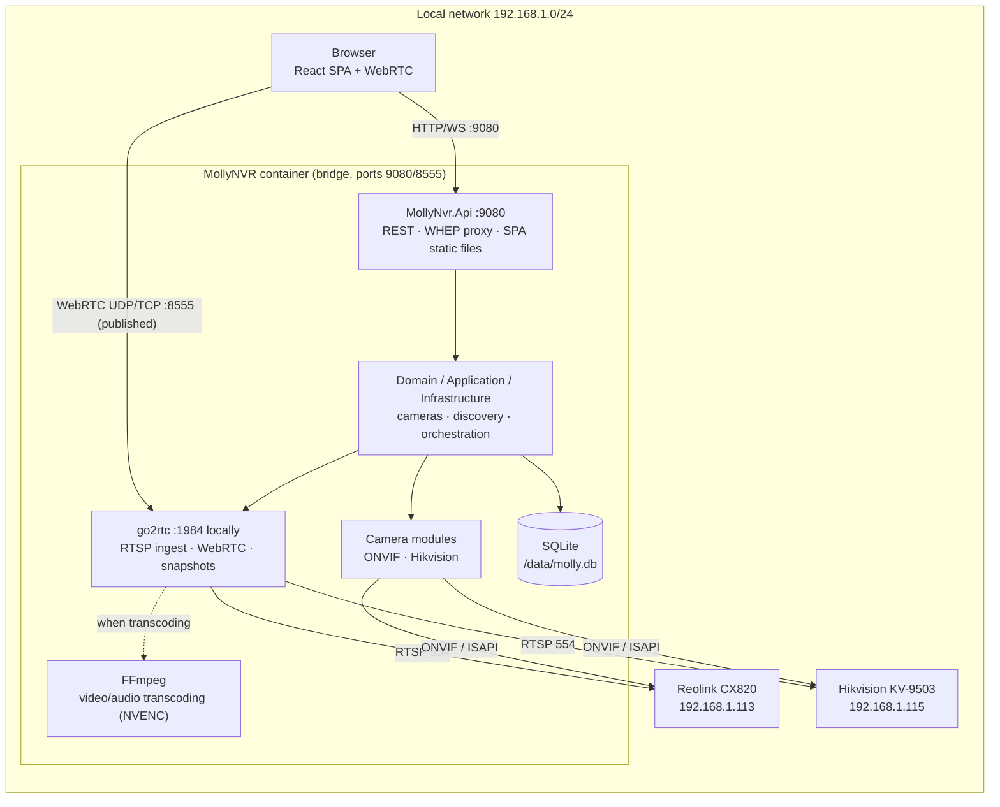
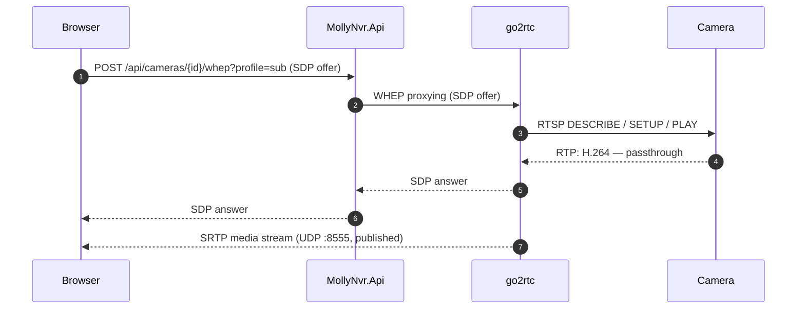
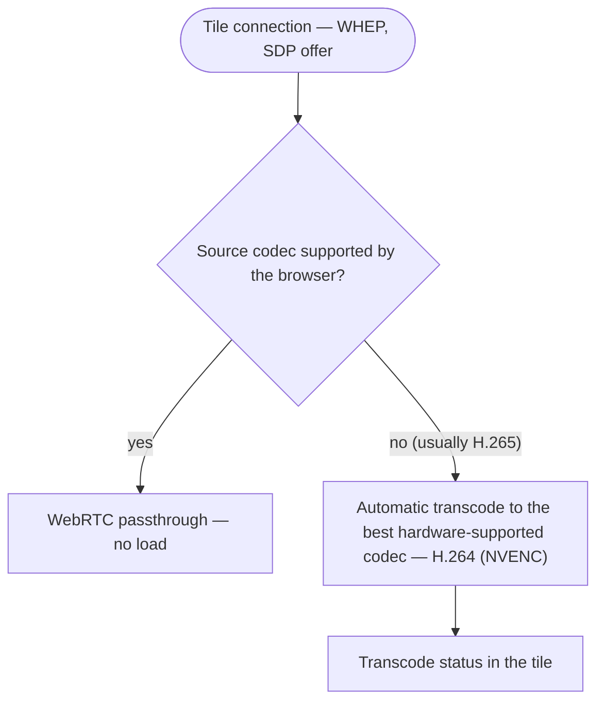
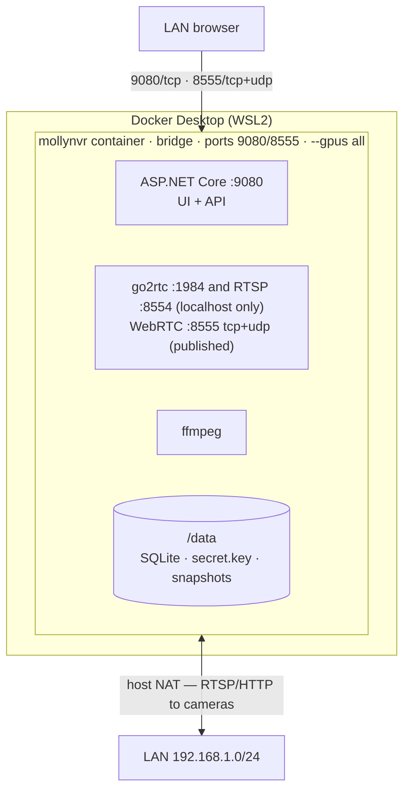

# MollyNVR architecture

**Status:** draft v0.1 for approval · **Date:** 2026-10-18 · **Stack:** .NET 10 + React

---

## 1. Goals and principles

- **Operational simplicity:** the whole solution is one Docker image; start with `docker compose up -d`. Upgrade by rebuilding the image.
- **Maximum automation:** camera discovery, profile selection, automatic codec detection, minimal manual configuration.
- **Live viewing is the core of v1.** Recording, detection and AI started as architectural groundwork (interfaces and extension points).
- **Passthrough by default:** video flows without transcoding; transcoding is enabled only on incompatibility and automatically (with a status in the UI).
- **Vendor modularity:** every camera brand is a pluggable module behind a stable contract.
- **Local first:** an application for a LAN, for personal use; no clouds.

## 2. Agreed decisions

| Question | Decision |
|---|---|
| v1 scope | Live viewing only (layouts, focus, audio). Recording and AI as groundwork |
| Cameras | `192.168.1.113` Reolink CX820, `192.168.1.115` Hikvision KV-9503; 4 in total on the network — the rest through discovery |
| Audio | Only on the focused tile (a single click focuses a tile and enables its sound, sound moves with the focus), global mute in the toolbar |
| Docker network | bridge + published ports `9080/tcp`, `9443/tcp` (HTTPS for PWA), `8555/tcp`, `8555/udp`. Reason: host networking in Docker Desktop on Windows does not forward UDP into the container (verified on M1), and WebRTC media runs over UDP. Discovery (multicast) is a separate M3 task, see section 15 risk 1 |
| H.265 | Automatic during viewing: passthrough when the browser supports the codec; otherwise automatic transcoding to the best codec with hardware support (NVENC). The add wizard asks nothing |

**Host hardware (verified):** Ryzen 5 5600 (6 cores/12 threads), **RTX 3060 Ti** (NVENC/NVDEC — hardware transcoding), 16 GB RAM. Free space: C: 6 GB (!), D: 91 GB, E: 142 GB. Docker Desktop 29.8.2 (WSL2). Host network — `192.168.1.151/24`.

> ⚠️ Only 6 GB free on drive C. Docker images and the WSL VHDX live on C by default — move the Docker data-root or free space before building (see section 11).

## 3. Context and components



| Component | Responsibility |
|---|---|
| **SPA (React + TS + Vite)** | Layouts, tiles, focus/audio, fullscreen, add-camera wizard. Served by Kestrel as static files — a single origin |
| **MollyNvr.Api** | REST API, WHEP proxy to go2rtc (only :9080 is exposed), health |
| **Domain / Application / Infrastructure** | Domain and use cases: camera registry, discovery orchestration, stream management. Infrastructure: SQLite (EF Core), go2rtc client, ffmpeg launch, credential encryption |
| **Vendor modules** | `ICameraModule` modules: discovery, connection check, profiles, snapshot. Implemented as separate .NET projects in the solution, registered through DI. For Reolink without RTSP/ONVIF — a module on top of the `neolink.net` bridge (Baichuan, port 9000) |
| **go2rtc** (MIT) | Media engine: pulls RTSP, serves WebRTC (WHEP) / MSE / snapshots, and starts ffmpeg source transcoding when needed |
| **FFmpeg** | Video (H.265→H.264, NVENC/CPU) and audio (→ Opus) transcoding on incompatibility |
| **SQLite** | Cameras and profiles. Credentials encrypted (section 12) |

**Why go2rtc:** MIT license, a single binary, dynamic source management through the HTTP API, built-in ffmpeg transcoding on the fly, WebRTC/MSE/HLS out of the box, maturity (used by Frigate and Home Assistant). The alternative, MediaMTX, is more mature for recording but needs external transcoding and is less dynamic; recording is a separate ffmpeg segmenter here, so go2rtc was chosen.

## 4. Video path (live)



- Grid tiles connect to the **substream**; a double click switches the tile to fullscreen and the **main stream** at maximum resolution; the "Fullscreen" button expands the whole grid, exit with `Esc`.
- Every tile is a separate WebRTC session (WHEP). The audio track is enabled only on the focused tile; the other sessions are muted. The global mute in the toolbar mutes all videos, including the active tile.
- go2rtc listens on `127.0.0.1:1984` (API/signalling — only through the backend proxy), `127.0.0.1:8554` (internal RTSP: publishing `ffmpeg:` sources and future transcodes; not exposed) and `:8555` TCP/UDP — media for LAN browsers (the port is published by Docker).
- WebRTC latency (SRTP/UDP, passthrough) is a fraction of a second, without HLS buffering.

## 5. Browser capabilities and codec policy

Your question: "is it possible to determine that the browser supports the video and audio stream?" — **yes, but there is no 100% guarantee "in advance"**. The right scheme is combined:

1. **The exact fact — WebRTC SDP negotiation.** In the offer the browser lists the codecs it is ready to accept. If the camera codec is in the offer — passthrough; if not — transcoding. The check happens at connection time, so it cannot be wrong.
2. **Early heuristics (for the UI):**

```ts
RTCRtpReceiver.getCapabilities('video')?.codecs            // WebRTC codecs of the current browser
MediaSource.isTypeSupported('video/mp4; codecs="hvc1.1.6.L120.90"')  // H.265 in MSE
await navigator.mediaCapabilities.decodingInfo({           // enough hardware and smooth playback
  type: 'file', video: { contentType: 'video/mp4; codecs="hvc1"' }
});
```

**Practical matrix:**

| Codec | WebRTC in Chrome/Edge | WebRTC in Firefox | Conclusion |
|---|---|---|---|
| H.264 | Yes | Yes | Passthrough everywhere |
| H.265 | Only with hardware decoding (usually yes on NVIDIA) | No | Do not rely on it — decided automatically during viewing |
| Audio G.711 (PCMU) | Yes | Yes | Passthrough |
| Audio AAC | No (not part of WebRTC) | No | Transcode → Opus |

**Automatic policy during viewing.** The decision is made when each tile connects, without dialogs — the add wizard asks nothing (different people have different browsers, so tying the decision to camera creation is wrong):
- the source codec is in the browser SDP offer → **passthrough**, zero load;
- otherwise → **automatic transcoding to the best target codec**: the best codec is chosen that both the browser supports and the server can handle in hardware (RTX 3060 Ti through NVENC: H.264/H.265; the practical choice is H.264, accepted by all browsers). Audio is transcoded to Opus when needed.

The result is kept for the session; the "transcode" status is visible in the tile. Manual camera codec switching is not provided — the policy is fully automatic.

**Audio (implemented in M4):** when the camera codec is not part of WebRTC (AAC, G.722.1), a second source `ffmpeg:<rtsp>#audio=opus` is added to the stream; video stays passthrough from RTSP and ffmpeg handles only the sound. PCMU/PCMA need no transcoding.

**Video (implemented in M5):** for H.265 profiles a fallback source `ffmpeg:<rtsp>#video=h264#hardware` is added (automatic CUDA/NVENC selection). go2rtc starts it only when the browser SDP offer has no H.265; with H.265 support the stream is passthrough without ffmpeg. The "transcode" status is shown in the tile, and the actual codecs are in the overlay on hover over Live.



## 6. Vendor modules

Contract (actual, `src/MollyNvr.Cameras.Abstractions/ICameraModule.cs`):

```csharp
public interface ICameraModule
{
    string Key { get; }                       // "onvif", "hikvision"
    string DisplayName { get; }
    Task<bool> CanHandleAsync(CameraEndpoint endpoint, CancellationToken ct);
    Task<CameraProbeResult> ProbeAsync(CameraEndpoint endpoint, CameraCredentials credentials, CancellationToken ct);
    Task<byte[]> GetSnapshotAsync(CameraEndpoint endpoint, CameraCredentials credentials, CameraProfile profile, CancellationToken ct);
    // planned: discovery (DiscoverAsync), PTZ, events, motion detection
}
```

- **Wiring:** a module is a separate .NET project in the solution (`MollyNvr.Cameras.ONVIF`, `MollyNvr.Cameras.Hikvision`) registered through DI in `MollyNvr.Infrastructure`. Adding a vendor means adding a project plus a registration. The contract lives in `MollyNvr.Cameras.Abstractions`; modules depend only on it (not on Domain/Application/Infrastructure).
- **Credentials:** passed through the contract as a separate `CameraCredentials` object; stream URLs exposed to clients contain no credentials (`RtspUriFactory` adds them only for internal calls). Passwords are never logged.
- **ONVIF (shared module):** ONVIF Device/Media services, WS-Security UsernameToken (PasswordDigest), RTSP through `GetStreamUri`, snapshot through `GetSnapshotUri`, DHCP through `GetNetworkInterfaces`. Main/sub profiles are detected by maximum resolution; audio is read from `AudioEncoderConfiguration` (codec, sample rate, bitrate). This module serves Reolink and other ONVIF-compatible cameras without a dedicated vendor project. For Reolink CX820 ONVIF is available on port **8000**, while HTTP port 80 may be closed — in that case the snapshot is taken as a frame from RTSP. Codecs are verified through SDP (RTSP DESCRIBE).
- **Hikvision KV-9503:** ISAPI on :80 (HTTP Digest), RTSP `/Streaming/Channels/101` (main) and `/102` (sub); ISAPI provides exact codecs/resolutions/fps/audio, snapshot `/ISAPI/Streaming/channels/{id}/picture`. The SDK port 8000 and ONVIF `/onvif/device_service` are not used.
- **Snapshot (M2):** the native module method first, and when it is unavailable — a frame from RTSP through go2rtc (`/api/frame.jpeg?src=…`); this also works for ONVIF cameras with a closed HTTP port.
- Substream profiles (resolution/codec/audio) are read and shown in the wizard — as requested, "video and audio formats".

## 7. Discovery

| Method | Transport | What it finds |
|---|---|---|
| ONVIF WS-Discovery | UDP multicast 239.255.255.250:3702 | Cameras/NVRs with ONVIF, XAddrs (the scopes name is not used as a model — it is a hardware identifier) |
| SSDP/UPnP | UDP multicast 239.255.255.250:1900 (M-SEARCH) | Device description: vendor, model; filtered to cameras/NVRs |
| mDNS/Bonjour | UDP multicast 224.0.0.251:5353 (`_rtsp`, `_onvif`, `_http`) | Camera IP addresses from A records |
| Hikvision SADP | UDP 37020 (multicast/broadcast) | Hikvision: MAC, model, IP |
| Subnet scan (unicast) | ICMP probe of the range, then TCP connect only to live hosts (4 s timeout, one retry on a silent SYN) | Everything that responds; vendor from MAC/OUI, protocol response or module |
| IP address | TCP connect on typical ports of one address | A specific device; vendor from the selected module or autodetection |

After discovery, vendor identification: MAC → OUI (a compact IEEE reference in `Application/Discovery/oui-cameras.csv`) outranks the protocol name ("ONVIF" is not a vendor), then the multicast protocol response, then the modules' `CanHandleAsync`. The result table shows IP, MAC, vendor, model and open ports; the "Connect" button is always available.

**Unicast:** CIDR/range/single address; the API returns all discovered devices, and the wizard hides cameras that are already added (by the saved list). First an ICMP probe of the range (only responding hosts), then the fast camera port set, then the full port list on the discovered hosts; the results are merged. The ICMP prefilter matters for Docker Desktop: a full port sweep across a /24 creates a connection burst that the NAT drops, and cameras with Wi-Fi power save answer SYN within 1-3 s. That is why the port timeout is 4 s with one retry on a silent timeout (an explicit RST is not retried), and ports already found are not checked again. When ICMP is unavailable or nobody responded, the whole range is scanned (the slow path). Hosts with only HTTP ports (routers) are discarded. **IP:** the result row is returned even without open ports. **Multicast:** only devices with at least one camera port open (554, 8554, 8000, 9000, 34567, 37777) reach the results — routers and web panels are discarded. Known ARP neighbours are scanned as well: this finds cameras that do not answer multicast (for example, Reolink with ONVIF/HTTP disabled). Requests go through an explicitly selected LAN interface (`MulticastInterface`): VPN adapters (Wintun/WireGuard) often capture the `224.0.0.0/4` route, and without this multicast silently finds nothing. A container on a bridge network does not see the LAN directly, so the methods return an empty list; the UI shows a warning and suggests a subnet scan. On the host or Linux multicast works; `scripts/run-local.ps1` exists for that. See section 15, risk 1.

**Reolink without RTSP/ONVIF (Baichuan):** some cameras (for example, E1 with HTTP/ONVIF/RTSP disabled) are reachable only over the proprietary protocol on port 9000. For them a separate `reolink` service runs — `neolink.net` (AGPL-3.0, a separate process, see `docs/third-party/neolink.net.md`): it connects to the camera over Baichuan and exposes RTSP plus an HTTP API. The `MollyNvr.Cameras.Reolink` module, when the vendor is selected, first tries standard ONVIF and then Baichuan: writes the camera to `data/reolink/config.json` (the bridge restarts), waits for `online`, reads the profiles from `/api/cameras/<name>/streaminfo`, takes the snapshot from `/api/cameras/<name>/snapshot.jpg`, and the streams are `rtsp://reolink:8654/<name>/mainStream|subStream`.

### Video recording

The engine is a separate `ffmpeg` per camera (video `-c copy`, audio to AAC: G.711/PCM are incompatible with fMP4; 5-minute segments), the source is the internal go2rtc RTSP (`rtsp://127.0.0.1:8554/camera-<id>-main|sub`): the camera keeps a single connection and the password never reaches the command line. The background `RecordingWorker` compares schedules every 10 s and wakes immediately after recording settings are saved (`IRecordingSettingsNotifier`), starting or stopping processes; the recording flag for the `REC` indicator is cleared when the stop begins, without waiting for ffmpeg to exit. Segments are indexed in `recording_segments`; `SegmentIndexer` keeps only those that intersect streaming schedule windows or events (+pre/post-roll) and deletes the rest with a delay (pre-roll for events that have not started yet). `StorageRetention` enforces the pool quota: FIFO or watermarking (high/low of the quota).

Events: `ICameraEventSource` in the modules — ONVIF PullPoint (`CreatePullPointSubscription`/`PullMessages`) and Hikvision ISAPI `alertStream` (multipart XML). `CameraEventMonitor` writes windows to `recording_events`. Reolink through the Baichuan bridge reports no events — schedule only.

API: `GET/PUT /api/cameras/{id}/recording`, `GET/PUT /api/settings/storage`. Tables: `recording_settings`, `recording_segments`, `recording_events`, `storage_settings` (EF Core, migration `AddRecording`).

### Archive

`/api/archive/*`: cameras, a per-month calendar, a per-day timeline (recording intervals + events) and HLS playback. `ArchiveService` selects a 2-hour window from the requested moment, stitches the segments and starts `ffmpeg` through `PlaybackSessionManager` (copy for H.264, hvc1 for HEVC, or transcoding to H.264 when the browser does not support HEVC). The resulting HLS files are served by the API, the cache is `<data>/playback-cache`, and stale sessions are removed by `PlaybackCleanupService`. The UI uses `hls.js` (loaded as a separate chunk).

### Archive

The segment and event index is read through `ArchiveService`: the calendar (days with recordings), the daily timeline (continuous intervals + event windows) and the camera list. Times in `recording_segments`/`recording_events` are stored in UTC (`DateTime`), so SQLite filters by intervals correctly; the `NormalizeRecordingTimes` migration converts old values.

Playback is HLS on demand. `PlaybackSessionManager` takes segments from the click point up to 2 hours ahead (within the day), concatenates them with `ffmpeg -f concat` and serves the playlist with fragments from `/data/playback-cache`; sessions live by TTL and are deleted by `DELETE`. H.264 is served with `-c copy`, H.265/MJPEG are transcoded to H.264 when the browser did not declare HEVC support. The API returns a "media time → real time" map: the client uses it to draw the red playhead and the time counter over the recording. Gaps between recordings collapse during stitching, so playback skips them automatically.

## 8. UI


- **Navigation:** a full-screen layout with "Live", "Archive", "Cameras" and "Settings" on the left. Version and go2rtc status are in "Settings".
- **Layouts:** 1, 2, 4 (2x2), 4 with a large tile, 6 (3x2), 6 with two large tiles, 9, 12 with a large tile and 12 (even). 4 with a large tile — a 4x3 grid: a 3x3 tile on the left and 3 cameras in the right column; 6 with two large tiles — a 4x3 grid: two 2x2 tiles on top (left and right) and 4 cameras in the bottom row; 9 — a 4x3 grid with a 2x2 large tile at the top left and 8 small tiles; 12 with a large tile — a 5x4 grid with a 3x3 large tile at the top left and 11 small tiles; 12 (even) — a 4x3 grid. Selection is the grid icon; a click opens a popover with thumbnails and tile counts; the active one is highlighted in blue.
- **Grid toolbar:** to the left of the layout picker — a global sound on/off button; after the layout — a "Fullscreen" button (native Fullscreen API for the whole grid, exit with `Esc`), then "Stretch image"; when enabled, the buttons are highlighted in blue and the video in all tiles fills the area (`object-fit: fill`). Toolbar icons are the same gray as the layout icon. Sound, stretch, layout, focus and tile order are stored in the browser `localStorage` and not on the server.
- **Each tile:** active cameras automatically fill the free places; the order can be changed by dragging (tiles swap places) and is remembered separately for each layout in the browser. Extra cameras are not shown.
- **Interaction:**
  - a single click — focus (border) and the sound of that camera; a click on another tile moves the sound;
  - mouse wheel — zoom of the image under the cursor (1x-6x); the zoomed image is dragged with the left mouse button, panning is bounded by the tile edges;
  - on the active tile — a volume icon with a slider (Windows 11 style); at zero volume, with global mute or an unsupported codec — a red icon;
  - double click — tile fullscreen plus the main stream at maximum resolution; a repeated double click (or Esc) returns to the grid (substream, the sound stays on the focused tile);
  - the "Fullscreen" button in the toolbar expands the whole grid; exit with `Esc`;
  - when the cursor is in the bottom third of a tile, round "Info" (overlay with camera details) and "Settings" (opens the camera settings page) buttons appear smoothly (200 ms) at the bottom center; on hover the button lightens, on press or in the active state it is highlighted in blue.
- **Indicators:** the Live indicator is hidden; only connecting / failed states are shown. After a connection loss or a go2rtc restart the tile reconnects automatically in 5 seconds. The codec is not shown on the image; when video is transcoded, a "transcode" badge appears. The information overlay (the "Info" button) shows the camera name and the video/audio parameters; the "Video is transcoded" and "Audio is transcoded" rows appear only on actual transcoding (for video — according to the actual codec from the SDP answer). When audio is unavailable because of the codec — a red icon with a prohibition sign; when muted — a red crossed-out speaker.
- **Add wizard (4 steps, implemented):** 1) search — Multicast (WS-Discovery/SSDP/mDNS/SADP), Unicast (CIDR/range) or IP address; the result table: IP, MAC, vendor, model, open ports, "Connect"; already added cameras are hidden. 2) connection — address, login, password, vendor (ONVIF plus connected modules), device card. 3) profiles — a table of all profiles with a radio button: the main profile is selected automatically by maximum resolution and locked, the others are numbered and the lowest resolution is selected by default; each has its own snapshot. 4) saving — metadata, camera name, a snapshot of the main stream instead of a preview, a summary of the selected streams. Navigation: a click on any previous step. After saving, the camera appears in a free grid tile.
- **M3 (implemented):** the "Cameras" page: a list of saved cameras, deletion, enable/disable, navigation to settings; the "+ Add" button opens the wizard, and discovery is built into the first wizard step. The enable column is first, without a header, with a toggle; a disabled row is dimmed. Then the "Name" and "Vendor" columns in that order. After saving, the camera survives a container restart.
- **Camera settings (implemented):** `/cameras/:id/settings` — a live preview with image and sound, device details (vendor, model, firmware, serial number, address, DHCP), a required name, a stream table with bitrate highlighting and a substream selector (the main stream is always enabled and locked, substreams are radio buttons). Resolution is shown as `1920×1080 Full HD · 2.1 MP · 16:9`; codecs are highlighted by browser support and ffmpeg transcoding availability, and a neutral dash is shown when audio is disabled. The ▶ button in a stream row switches the preview to the main or a specific substream; the main stream is active on open. Saving is done with the "Save" button (`PUT /api/cameras/{id}/settings`) with a green toast for 3 seconds; the "Back" button returns to the previous page. DHCP is requested through `GET /api/cameras/{id}/network`; the draft in the wizard shows "No live preview".
- **M4 (implemented):** the "Live" section: layouts 1, 2, 4 (2x2), 4 with a 3x3 tile, 6 (3x2), 6 with two 2x2 tiles, 9, 12 with a large tile and 12 (even); active cameras occupy free tiles; drag and drop swaps tiles and is remembered for each layout; a click focuses a tile, the volume icon appears only on the active tile (a Windows 11 style slider; mute — a red crossed-out speaker, an unsupported codec — a red prohibition sign), the global mute is to the left of the layout; the mouse wheel zooms under the cursor and the zoomed image pans with the left button; a double click opens tile fullscreen with the main stream, the "Fullscreen" button expands the whole grid (exit with Esc); AAC audio → Opus through an ffmpeg source; the "Info" and "Settings" buttons appear when the cursor is in the bottom third of a tile; the Live indicator is hidden, connecting/failed states are shown; layout, order, focus, stretch and mute are stored in `localStorage`. The "Saved cameras" page has an enabled/disabled toggle and editing (disabled cameras are hidden from the grid and their streams are removed from go2rtc). In the top left corner of a tile, while recording is active, a blinking `REC` dot and trigger icons are shown (schedule and/or open events, `GET /api/recording/status` polled every 5 s); the "Archive" button in the tile panel opens the archive for that camera.
- **M6 (implemented): archive.** A separate "Archive" tab: the active camera list is under the menu item, no camera is selected by default; selecting a camera loads the calendar and the timeline. The player is on top, below it the control panel (date, time, filters, transport, speed 1/2/4/8, multi-camera view), then the 0-24 h timeline; the date opens the calendar upwards (dots mark days with video, it closes on date selection or Esc). On the timeline gray bars are the schedule and blue bars on top are events; dragging scrolls, a click plays from the nearest recording to the right, the red playhead is the current position. "Multi-camera view" splits the area into 4 tiles: cameras are dragged from the menu, tiles can be swapped, playback is synchronized; under the shared time scale there is one bar per camera in tile order, the active one is highlighted, sound comes only from it, and the red playhead is shared. The player and the grid take all free space, the control panel and the timeline are pinned to the bottom. The "Record" and "Snapshot" buttons are on the image and appear on hover; recording shows a blinking dot and `REC hh:mm:ss`. Recording and snapshots are done in the browser (`MediaRecorder` plus canvas), and the format (PNG/JPEG, WebM/MP4) is stored in `localStorage` (the "Settings" section). The "Fullscreen" button is on the control panel (expands the player or the 2x2 grid). The default date is today. From a live tile, the "Archive" button opens the archive for that camera.
- **PWA:** `manifest.webmanifest`, a service worker (caches the shell, does not cache the API/HLS), 192/512 and maskable icons; `start_url=/live`, `display=standalone`. Installing as an app requires HTTPS: on `http://<LAN-IP>:9080` the service worker is unavailable (localhost is the exception).
- **Language:** English is the default UI language, Russian is available in "Settings" (the choice is stored in the browser). All UI strings go through the localization dictionaries (i18n).

## 9. Stack and solution structure

```
MollyNvr.slnx                       # clean architecture (.slnx — the .NET 10 solution format)
├─ src/
│  ├─ MollyNvr.Domain/              # entities, value objects, domain interfaces (ports)
│  ├─ MollyNvr.Application/         # use cases: AddCamera, ScanNetwork, OpenStream, CodecPolicy…
│  ├─ MollyNvr.Infrastructure/      # EF Core + SQLite, go2rtc client, ffmpeg launch,
│  │                                # WS-Discovery/SADP/scanning, credential encryption — port implementations
│  ├─ MollyNvr.Api/                 # ASP.NET Core: REST, WHEP proxy, SPA static files, go2rtc host
│  ├─ MollyNvr.Cameras.Abstractions/# vendor module contract (ICameraModule, DTOs)
│  ├─ MollyNvr.Cameras.ONVIF/
│  └─ MollyNvr.Cameras.Hikvision/
├─ ui/                              # React 19 + TypeScript + Vite
├─ tests/                           # xUnit: Domain, Application, Infrastructure (EF/SQLite, AES), modules (ONVIF/ISAPI/SADP parsers)
├─ docker/                          # Dockerfile, compose.yaml, entrypoint
└─ docs/                            # this document
```

- Dependency rule (clean architecture): Domain <- Application <- Infrastructure/Api; Domain knows nothing but the BCL; modules depend only on `Cameras.Abstractions`; the DI container is composed in Api.
- .NET 10 (`net10.0`), nullable enabled, `TreatWarningsAsErrors` for Domain/Application and all `MollyNvr.Cameras.*`.
- Tests are xUnit; for the ONVIF/ISAPI/SADP parsers they are mandatory (text fixtures).
- UI: React 19 + TS, minimal state (Zustand), no heavy frameworks; WebRTC through the native API plus WHEP.

## 10. API (v1)

| Method and path | Purpose |
|---|---|
| `GET /api/system/info` | Versions, go2rtc/ffmpeg status |
| `GET /api/discovery/settings` | Default discovery range (M3) |
| `POST /api/discovery/scan` | Unicast subnet/CIDR/range scan: IP, MAC, vendor, model, open ports |
| `POST /api/discovery/multicast` | Multicast discovery: WS-Discovery, SSDP, mDNS, Hikvision SADP |
| `POST /api/discovery/ip` | Check a single IPv4 address; optional vendor module key |
| `GET /api/cameras/modules` | List of vendor modules (M2) |
| `POST /api/cameras/probe` | Probe a camera without saving: device plus main/sub profiles (M2) |
| `POST /api/cameras/snapshot` | JPEG snapshot of a profile: native method or a frame from RTSP (M2) |
| `GET /api/cameras` | Saved cameras with profiles (M3) |
| `POST /api/cameras` | Add a camera: check → database → streams in go2rtc (M3) |
| `GET /api/cameras/{id}` | Camera by identifier (M3) |
| `GET /api/cameras/{id}/network` | Camera network parameters: `dhcpEnabled` (may be `null`) (M3) |
| `PUT /api/cameras/{id}` | Probe again and update the camera (M3) |
| `PUT /api/cameras/{id}/settings` | Save the name and the selected substream (M3) |
| `DELETE /api/cameras/{id}` | Delete the camera and its streams (M3) |
| `PUT /api/cameras/{id}/active` | Enable/disable the camera; inactive cameras are hidden from the grid (M4) |
| `GET /api/cameras/{id}/snapshot?profile=sub\|main` | Snapshot of a saved camera (M3) |
| `POST /api/cameras/{id}/whep?profile=sub\|main` | WebRTC session of a camera: substream for the tile, main stream for fullscreen (M4) |
| `POST /api/streams/{id}/whep?profile=sub\|main` | WebRTC connection (proxy to go2rtc) |
| `GET/PUT /api/cameras/{id}/recording` | Camera recording settings: schedule, events, pre/post-roll |
| `GET /api/recording/status` | Active recordings: camera, start time, schedule, open events (for the REC indicator) |
| `GET/PUT /api/settings/storage` | Storage pool: path, quota, overwrite mode |
| `GET /api/archive/cameras` | Archive cameras and the today's recordings mark |
| `GET /api/archive/cameras/{id}/calendar?year=&month=` | Days of the month that have recordings |
| `GET /api/archive/cameras/{id}/timeline?date=` | Recording intervals and events for a day |
| `POST /api/archive/playback` | HLS session from `from`; `supportsHevc` selects copy or transcoding |
| `DELETE /api/archive/playback/{sessionId}` | Stop the session and delete the fragments |
| `GET /api/archive/playback/{sessionId}/{file}` | HLS playlist and fragments (`Range` supported) |
| `GET /api/health` | Liveness/readiness |

## 11. Docker and deployment



- **One container.** ASP.NET Core starts go2rtc as a child process (health check, automatic restart, shutdown on exit) — this removes the supervisor and simplifies operations: "start the container" is one command.
- **Network — bridge plus published ports** (`9080/tcp`, `8555/tcp`, `8555/udp`). Verified on M1: host networking in Docker Desktop on Windows **does not forward UDP** into the container (no UDP listener on :8555 appears on Windows) — WebRTC media (SRTP/UDP) never reaches the browser. Bridge with published UDP works. RTSP/HTTP to cameras go through the host NAT.
- **Ports:** exposed — `9080` (UI/API/WHEP) and `8555` (WebRTC media, TCP+UDP). go2rtc binds to `127.0.0.1:1984` (API) and `127.0.0.1:8554` (internal RTSP — publishing `ffmpeg:` sources and future transcodes); neither is exposed.
- **ICE candidate:** the host LAN address is not visible from the container — it is set explicitly (`Go2Rtc__WebRtcCandidates__0=192.168.1.151:8555`).
- **`--gpus all`** — for NVENC during transcoding; verified in M1 (in WSL2 NVENC is usually available). If not — CPU fallback and a preference for switching the camera to H.264.
- **Volume:** `./data:/data` — SQLite, encryption key, snapshots; recordings later go here too. The go2rtc config with camera URLs stays outside the volume (tmpfs).
- **Drive C:** 6 GB free — before building, move the Docker data-root to D:/E: (Docker Desktop → Settings → Resources → Advanced) or free space. Otherwise the image (~0.7-1 GB) may not fit.
- **Dev mode (no Docker):** `go2rtc.exe` locally (in `tools/`), `dotnet run --project src/MollyNvr.Api`, `npm run dev` in `ui/` (Vite proxy to :9080).

## 12. Security

- Camera credentials are **never** stored in plain text: AES-GCM encryption (M3: login and password in one encrypted string, a nonce per record), the key is generated on first start into `/data/secret.key` (mode 0600). Logs and the API only show masked values.
- The go2rtc config (it contains working URLs with passwords) is not stored in `/data`: it is written to `/dev/shm/mollynvr` (tmpfs) or a temporary directory; the old `/data/go2rtc.yaml` is deleted at startup.
- The API is not exposed externally (only LAN :9080). UI authentication in v1 is an optional password (JWT planned); for personal LAN use it is disabled by default.
- Input validation: IP/port/URL/credentials on addition; no shell concatenation — process arguments only.
- Credentials for debugging come from `appsettings.Development.json` or environment variables (never git).

## 13. Extension points (groundwork, not implemented in v1)

| Direction | Groundwork |
|---|---|
| Recording and archive | Implemented: ffmpeg segments, schedule/events, retention, HLS viewing. Next — fragment export. |
| Fragment export | Export a selected interval to MP4 (`ffmpeg -c copy`), a job queue and notifications |
| Events, motion | Camera event contract (`ICameraEvents`), in-process channel bus, `events` table |
| Object, plate, face detection | A frame pipeline: the snapshot endpoint exists; `IObjectDetector`/`IFrameAnalyzer` interfaces (empty) |
| AI description search | A metadata table plus an embeddings column in the database (reserved), a separate service later |
| MQTT integrations | Publish events to an MQTT broker (for example, an object detected) for Home Assistant and others — to be designed later |

## 14. Development plan (stages)

| Stage | Content | Definition of done |
|---|---|---|
| **M0. Skeleton** | solution, projects, SPA stub, Docker image, health | ✅ `docker compose up` opens the UI and health from the container |
| **M1. Media engine** | go2rtc as a child process, manual RTSP source, WebRTC in one tile | ✅ Live from the real `.113` camera (Reolink, H.264 substream) in a browser through the container; credentials for `.115` are being clarified (the camera answers 401) |
| **M2. Modules** | `ICameraModule`, ONVIF + Hikvision: probe, profiles, snapshot | ✅ Profiles of both cameras are visible in the API (codecs verified through SDP); snapshots work for both (Hikvision — ISAPI, ONVIF — a frame from RTSP); xUnit: ISAPI/ONVIF parsers, SDP, Digest, probe service (80 tests) |
| **M3. Registry and discovery** | SQLite/EF Core + migrations, AES-GCM, subnet scan, camera CRUD, UI wizard | ✅ Range discovery finds cameras (ONVIF — :8000, Hikvision — ISAPI :80); the camera is saved to the database, survives a restart, and streams are registered in go2rtc; passwords in the database are encrypted; UI: camera list, discovery, check and save (119 tests) |
| **M4. Live UI** | Layouts, assignments, focus/audio, fullscreen/main | ✅ "Live": 1, 2, 4 (2x2), 4 with a 3x3 tile, 6 (3x2), 6 with two 2x2 tiles, 9, 12 with a large tile and 12 (even); active cameras automatically in tiles; focus, global mute and tile volume; tile fullscreen with the main stream; whole-grid fullscreen; drag and drop; stretch to the whole tile; wheel zoom and panning; "Info"/"Settings" buttons in the bottom third of a tile; the Live indicator is hidden; AAC audio → Opus; layout, order, focus, stretch and mute in localStorage; enabled/disabled toggle |
| **M5. Codec policies** | Automatic policy during viewing (passthrough → transcode to the best codec, NVENC) | ✅ H.265 → H.264 (`ffmpeg:#video=h264#hardware`, CUDA/NVENC) is added as a fallback source and starts only when the browser SDP has no H.265; for an H.265 browser — passthrough without ffmpeg. AAC audio → Opus only for an incompatible codec. "Transcode" status in the tile, actual codecs in the overlay (160 tests) |
| **M6. Recording and archive** | ffmpeg segments, schedule/events, retention, HLS archive | ✅ Scheduled and event recording, calendar/timeline/player, H.265→H.264 only without support; xUnit: interval stitching and the playback map |
| **M6. Final** | 4 cameras on the network added, clean compose, README | ✅ 4 cameras in the registry (CX820, E1 Outdoor, RLC-420, Hikvision), all active; README and `.env.example`, env substitutions, healthcheck; the go2rtc config outside the volume; a clean container rebuild verified |

## 15. Risks and assumptions

1. **UDP into the container (verified on M1):** host networking in Docker Desktop on Windows does not forward UDP — WebRTC media does not pass. Solution: bridge plus published `8555/tcp+udp`. Consequence: multicast discovery (WS-Discovery/SSDP/mDNS/SADP) from a bridge container gets no LAN responses; a best-effort implementation with a UI warning exists, and the working path in the container is a unicast subnet scan and IP mode. On the host or Linux multicast works.
2. **NVENC in a WSL2 container** — verified in M5: `/api/ffmpeg/hardware` reports `hardware=cuda` for H.264/H.265, and ffmpeg with `h264_nvenc` starts when the request has no H.265; when H.265 is supported ffmpeg does not start (passthrough). Fallback — CPU transcoding (4K is heavy for a Ryzen 5 5600).
3. **Reolink CX820:** HTTP port 80 is closed (verified) — the native snapshot and part of the HTTP control are unavailable; ONVIF :8000 and RTSP are used (the snapshot is a frame from RTSP through go2rtc).
4. **Exact models/APIs** of CX820 and KV-9503 were verified on live devices (M2): the ISAPI/ONVIF parsers are covered by fixtures of real responses.
5. The local network has no VLAN isolation; if IPv6 or client isolation appears, ICE may require TURN (not planned in v1).
6. **Audio.** AAC (Reolink) is transcoded to Opus through ffmpeg and works in WebRTC (M4). G.722.1 (Hikvision DS-KV9503) has no decoder in FFmpeg — this camera produces no sound until G.711ulaw/PCMU (or AAC) is selected in its settings. In the UI such a profile is marked with a red prohibition sign and a status in the overlay.
7. **Reolink Baichuan (AGPL).** Cameras without RTSP/ONVIF are served by a separate `neolink.net` service (AGPL-3.0, a separate process, no code linking). Conditions: a second container in compose, the camera password in `data/reolink/config.json` in plain text, a first-probe delay (bridge restart). If HTTP/ONVIF are enabled on the camera, ONVIF takes priority and the bridge remains a fallback.

## 16. Approval summary

| Item | Decision |
|---|---|
| go2rtc media engine | ✅ confirmed |
| Drive C: move the Docker data-root to D:/E: | ✅ yes, done in M0 |
| UI authentication | ✅ disabled in v1 (LAN); to be added later, the interface is planned |
| Stages M0-M6 | ✅ agreed; M0 — after this document update |
| One container or two services | ✅ one container chosen |

**Reference: "one container" or "two services in compose"**

- *One container* — backend, go2rtc and ffmpeg inside a single image; go2rtc is started by the backend as a child process. One entity, one log, one volume; start with `docker compose up -d`. Upgrade — a completely new image.
- *Two services* — an `nvr` container and a `media` container (go2rtc), one `docker compose up -d`. They upgrade independently (for example, only media), with a cleaner separation of responsibilities. The downside is two entities instead of one.

**Decision: one container** — simplest for personal use, and go2rtc is upgraded by rebuilding the image (rarely).

---

## Appendix. Glossary

- **WebRTC** — low-latency media delivery technology: the stream reaches the browser as UDP packets (SRTP) instead of an HTTP download. This is what gives "live" video with sub-second latency.
- **WHEP** — WebRTC-HTTP Egress Protocol: a simple way to establish a WebRTC session over plain HTTP (the browser sends an SDP offer → receives an SDP answer). *"WHEP proxy"* — our backend accepts such a request from the browser and forwards it to go2rtc: only port 9080 is exposed, and go2rtc is reachable only from localhost.
- **SDP offer/answer** — a textual description of a media session, including the list of codecs the side can accept. The browser SDP offer is a 100% accurate codec compatibility check.
- **NVENC / NVDEC** — NVIDIA hardware video encoder and decoder (in the RTX 3060 Ti). NVENC transcoding puts almost no load on the CPU; CPU transcoding is the fallback when the GPU is unavailable.
- **MSE** (Media Source Extensions) — a browser JavaScript API for feeding video into `<video>` (fMP4). A fallback delivery channel when WebRTC does not fit; go2rtc supports it too.
- **Opus** — an audio codec guaranteed to be accepted by all browsers in WebRTC (mandatory per the WebRTC standard). AAC is not part of WebRTC, so AAC audio from a camera is transcoded to Opus; G.711 (PCMU) usually passes without transcoding.
- **Passthrough / transcoding** — passthrough: the camera stream is forwarded as is (almost zero load); transcoding: re-encoding to another codec/resolution (needed only when the browser does not understand the source codec).
- **RTSP** — the standard video stream protocol of IP cameras (port 554); go2rtc pulls streams over it.
- **ONVIF** — the standard interface for camera discovery and control (profiles, codecs and so on); **ISAPI** — the Hikvision HTTP API; **SADP** — the Hikvision device discovery protocol; **WS-Discovery** — the standard multicast discovery for ONVIF devices.
- **go2rtc** — the media engine of the solution (MIT license): pulls RTSP, serves WebRTC/MSE, makes snapshots and drives ffmpeg transcoding.
- **Kestrel** — the built-in ASP.NET Core web server: serves the API and the UI static files.
- **SQLite / EF Core** — a file database and the .NET ORM: cameras and profiles.
- **AES-GCM** — encryption of camera passwords in the database; the key is stored in `/data/secret.key`.
- **Vite** — the bundler and dev server for the React application.
- **i18n** — UI localization (string dictionaries); the language can be switched in the settings.
